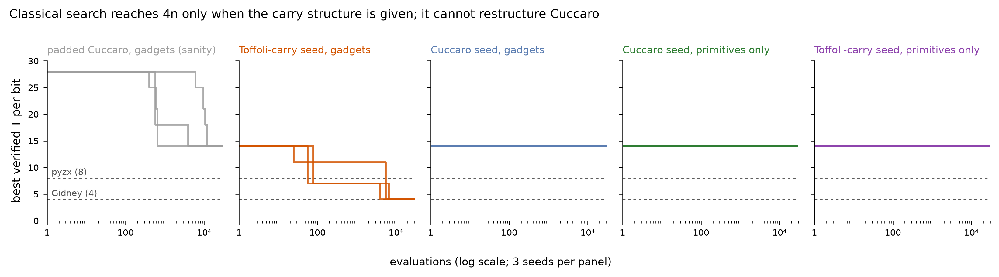

# P3 classical search: go/no-go report

*2026-10-06. Budget 30,000 verified-unique evaluations per run, 3 seeds per configuration, MAP-Elites
with six mutation operators over the bit-slice representation (`circuitevolve/search/`). Every winner
was re-verified at n = 1..16 with the full exact verifier (gadget shortcut off). Raw rows:
`results/classical_search.csv`; per-run trajectories and best programs: `results/runs/`.*

| Configuration | Seed T/bit | Best T/bit (3 seeds) | Evals to best | Reading |
|---|---|---|---|---|
| sanity: padded Cuccaro, tier A | 28 | 14, 14, 14 | 656 / 3,926 / 11,833 | machinery removes waste |
| Toffoli-carry seed, tier A | 14 | **4, 4, 4** | 6,629 / 3,949 / 5,538 | rediscovers Gidney's program exactly (32 T at n = 8) |
| Cuccaro seed, tier A | 14 | 14, 14, 14 | — | cannot restructure the carry chain |
| Cuccaro seed, tier B | 14 | 14, 14, 14 | — | no improvement |
| Toffoli-carry seed, tier B | 14 | 14, 14, 14 | — | cannot assemble the 4-T AND from primitives |

## Decision: GO for P4

The P3 gate in `docs/TEST_PLAN.md` asks two things.

1. **Does the harness run search reliably?** Yes. 15/15 runs completed (5 min wall-clock on 10
   processes); all 15 winners passed full exact re-verification at n = 1..16; the verifier still
   classifies the acceptance suite 21/21 with and without the search shortcut.
2. **Does classical search already solve the problem?** No, and the failure is informative:
   - When the *structure* is supplied (Toffoli-carry seed: separate carry wires, Gidney's carry
     recurrence), plain mutation finds the gadget substitutions and reaches 4n in all seeds within
     ~4–7k evaluations. Substituting gadgets is easy.
   - From the textbook Cuccaro adder it never gets below 14n, in either tier. Cuccaro keeps its carry
     *in place* in a_i, which is not a clean target, so no single gadget substitution is valid; getting
     to 4n needs a coordinated change (new carry wires + new recurrence + gadgets) with no verified
     intermediate on the way. The correctness gate gives random mutation no gradient across that gap.
   - In tier B nothing improves: the 4-T AND is a 13-gate block with no verified partial versions.

So the open targets for the LLM arms are exactly the three flat rows: **Cuccaro→<8n (tier A and B)**
and **AND-gadget invention (tier B)**. The Toffoli-carry/tier-A row is solved classically and should
not be used to claim any LLM advantage.

## Caveats a reviewer will raise

- **Classical arm strength.** This is mutation-only MAP-Elites. Before claiming LLM advantage, add a
  stronger classical arm on the flat rows: larger budget (10^6), crossover between archive members,
  and/or bounded enumeration of short templates (Gidney's tier-A program is only 9 template gates).
- **Representation bias.** The bit-slice roles (pa, pc, cout) make Gidney's structure *expressible*;
  they do not make it reachable, as the Cuccaro rows show. LLM arms must use the same representation.
- **Search-side settings** (recorded in `results/CHANGELOG.md`): fitness ranks T per bit first; at most
  2 measurement events per bit; tier-A-only candidates use the exactly-proven gadget lemma for L2
  during search. The first launch (before these settings) stalled on 7/15 runs and was discarded.

## Next (P4)

LLM proposer that edits the `FWD/TOP/BWD` source (`search/slice.py:to_source`) with the same
evaluator, budget accounting in evaluations, and guards for OpenEvolve's silent-failure modes. First
experiment: zero-shot vs evolution vs blinded evolution on the three flat rows.
