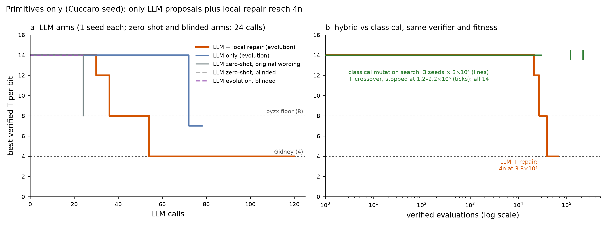

# P4 pilot: LLM proposer vs classical search

*2026-10-06. Proposer model: the platform's Sonnet-class reasoning model with thinking disabled (with
thinking on, every response spent its whole budget reasoning and returned no text). k = 4 programs per
call, 6 calls per batch. One seed per arm, so these are pilot results, not statistics. Logs of every
LLM interaction: `results/llm_runs/*.jsonl`.*

## Results

| Row | Arm | Calls | Best T/bit | Notes |
|---|---|---|---|---|
| Cuccaro, tier A | classical (P3 + 10⁶ run stopped at 3.2–4×10⁵) | — | 14 | never improves |
| Cuccaro, tier A | LLM evolution, original wording | 24 | **4** | first batch, before any feedback |
| Cuccaro, tier A | LLM zero-shot, blinded | 24 | **4** | first batch |
| Cuccaro, tier A | LLM evolution, blinded | 24 | **4** | by call 12 |
| Cuccaro, tier B | classical (P3 + 10⁶ run stopped at 1.2–2.2×10⁵) | — | 14 | never improves |
| Cuccaro, tier B | LLM zero-shot, original wording | 24 | 8 | relative-phase-Toffoli adder (2n+2 qubits) |
| Cuccaro, tier B | LLM zero-shot / evolution, blinded | 24 / 24 | 14 | 1 accepted proposal out of ~175 |
| Cuccaro, tier B | LLM evolution | 78* | 7 | 5 of ~270 proposals pass |
| Cuccaro, tier B | **LLM evolution + local repair (300)** | 120 | **4** | 8n at call 36, 4n at call 54 (3.8×10⁴ evals) |

\* stopped at 78 of 120 calls when the session's model-token allowance (2M tokens) ran out.

## Key insights

1. **Tier A is recall.** With the AND gadgets supplied, the model writes the 4n construction in its
   first batch, before any feedback. Under blinding, all 24 responses still identified the task as
   ripple-carry addition. "Gidney" appeared in 4 (zero-shot) and 5 (evolution) of 24 responses;
   "Cuccaro" in 4 and 17. Renaming identifiers does not blind a textbook problem: the specification and
   the seed's shape are enough. The adder can calibrate the harness; it cannot show discovery.
2. **In tier B, knowing the idea is not the same as executing it.** Every response named
   measurement-based uncomputation as the lever, yet fewer than 2% of proposals passed. Failures are
   mostly wiring/precondition errors (L1); several computed the right truth table with a wrong relative
   phase (L2).
3. **LLM structure + classical repair beats both alone.** The 4n step came from an LLM proposal the
   phase check rejected, repaired by a single local edit (inserting `s(cout)` before the uncompute
   Hadamard). LLM alone: 7 after 78 calls. Classical alone: 14 after up to 2.2×10⁵ evaluations.
   Hybrid: 4 after 54 calls / 3.8×10⁴ evaluations. 35 of the hybrid's 69 accepted programs came
   through repair.
4. **The phase check is load-bearing.** Without L2, the unrepaired proposal (wrong relative phase) would
   have been accepted as a 4n adder.
5. **The found construction differs from the reference.** It keeps Cuccaro's in-place carry, computes
   the AND with a 4-T relative-phase Toffoli into a fresh wire, and uncomputes it by measurement. At
   n = 16: 64 T, T-depth 34, 161 CNOT, 50 qubits, versus Gidney's 64 / 17 / 186 / 48. Relative-phase
   Toffolis with measurement uncompute are known in the literature (e.g. Jones 2013), so no novelty
   is claimed. Saved in `results/discovered/`.
6. **Harness failure modes seen live:** CLI returning `subtype: success` while not logged in; hidden
   thinking consuming the whole token budget (empty text); thinking budget treated as advisory. All are
   now counted as errors.

## Next

1. Seeds: 3+ per arm on tier B (hybrid vs LLM-only vs classical-with-same-repair-budget), via
   `experiments/search_llm.py` in a logged-in terminal (this session's model allowance is used up).
2. Repair-only control at matched evaluations (classical repair applied to random proposals) to show
   the LLM's structure, not the repair, carries the gain.
3. P6 target without a known answer (controlled adder, comparator, modular adder or multi-controlled X),
   scored on T-count, T-depth and qubits together.
