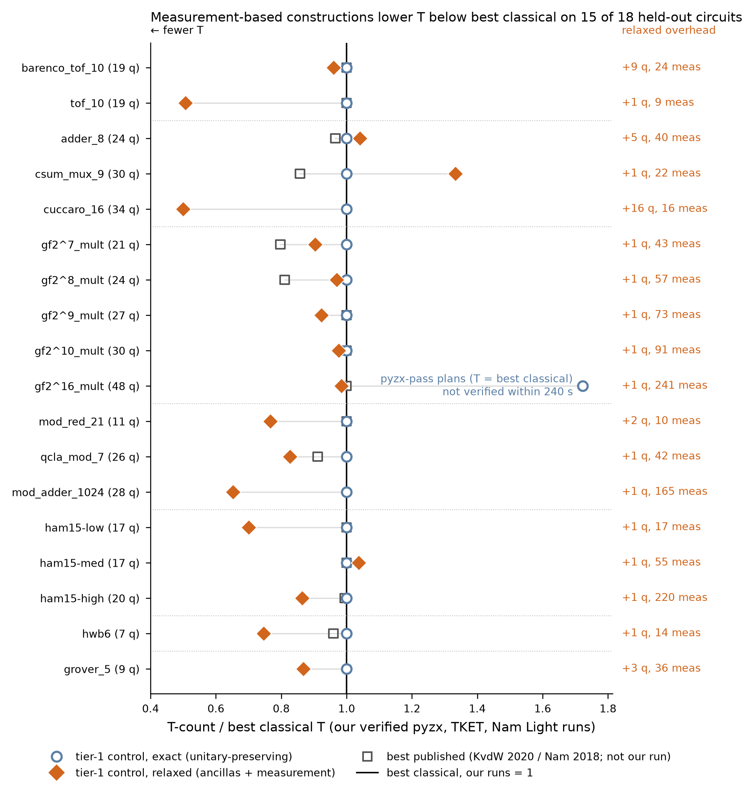

# v2 held-out evaluation report (run `eval_v1`)

Track "Evaluation", 2026-10-14. Split `v2-nam-arith-1`, HELD-OUT circuits only. **No LLM arms** (user decision after the DEV phase: both LLM arms were null on DEV); LLM tokens used in this evaluation: 0. Code: `experiments/v2_eval_heldout.py` (runs), `experiments/v2_eval_report.py` (this file + `eval_results.csv`), `experiments/v2_eval_figure.py` (figure). Raw per-circuit records: `per_circuit/<tag>_<circuit>.json`; per-evaluation logs: `logs/`; verified circuits: `circuits/`.

## Verdict

1. **LLM arms: null on DEV, not run on held-out (by decision).** Tier 1: the LLM never produced a verified plan with lower T than the deterministic no-LLM control at the same budget (exact 16/16 equal; relaxed 13 equal, 2 worse, 1 no valid plan). Tier 2: neither the LLM arm nor the enumeration control lowered DEV T (758 -> 758); both primary libraries froze at v0 (empty). See the DEV summary below.
2. **Unitary-preserving (exact) results do not beat best classical on held-out.** The frozen tier-1 control in exact mode equals the best of our classical runs on 17/18 circuits and is worse on 1 (gf2^16_mult: its pyzx-pass plans reach T = best classical but did not finish verification within the frozen 240 s limit, so the best VERIFIED exact plan is the one without a global pass). The frozen tier-2 library v0 is empty: T unchanged on all 18 start circuits and on all 18 tier-1 exact outputs (0 rule applications). The secondary control library (30 gate-count rules, dT = 0 by construction) also leaves T unchanged and removes 361 of 17531 gates on the classical start circuits (2.1 %) and 1338 of 26671 on the tier-1 exact outputs. The best published unitary-preserving numbers (mostly pyzx+TODD, Kissinger & van de Wetering 2020; not run by us) are lower than our best classical run on 7 of 15 circuits that have a published value.
3. **Measurement-based constructions (relaxed contract) lower T below best classical on 15/18 held-out circuits** (worse on 3: adder_8, csum_mux_9, ham15-med); total T over the 18 circuits 4968 vs 5728 for best classical (-13.3 %). min(exact, relaxed) is below best classical on 15/18 and equal on 3. Relaxed T is also below the best PUBLISHED unitary-preserving value on 10 of 15 circuits with a published value. The price is extra qubits (+1 to +16), mid-circuit measurements (9 to 241) and, where the plan relies on them, a zero-init promise on the declared ancilla qubits of the benchmark (a different contract from the unitary benchmarks; see table B).
4. **These gains are known constructions, not LLM discoveries.** Every winning relaxed plan is the deterministic control variant V2 (`max_relaxed`) + pyzx: Gidney's temporary logical-AND with measurement-based uncomputation (arXiv:1709.06648, 2018), Jones' 4-T Toffoli with measurement (PRA 87, 022328, 2013) and the compute-only clean AND, applied by a fixed rule. No LLM was involved on held-out, and on DEV the LLM selected the same routes no better than this rule.

## Freeze check (before every circuit)

- `results/v2/tier1/FROZEN.md`: 21 file SHA-256s re-checked (recognizer, plan, compile, prompt, loop, control, v2 verify/metric, dev driver, 12 card files): all equal. Frozen verifier digest `bc3eac23a403dbc5...` equal before and after every circuit.
- Tier-2 libraries re-loaded with every rule re-verified exactly: `library_final.json` v0, 0 rules, SHA-256 `4f53cda18c2baa0c...`; `library_lex_secondary_control.json`, 30 rules, SHA-256 `4bef8a90eb7cccad...` (both equal to the `.sha256` files). Previous library version: none (v0 is the first and only accepted primary version), so "vs previous version" is v0 vs the unmodified start circuit.
- Evaluation budget = the DEV rule: 8 compile+verify evaluations per circuit (= 8 LLM calls per DEV circuit; control order `control.ORDER[:8]`: V1/V2/V3/V4 + pyzx, V2/V1/V3 + none, V2 + pyzx_then_tket), verifier limits `compile.DEFAULT_LIMITS` (branch_budget 131072, 240 s). The control is deterministic, so one run is the whole distribution; the "2-3 seeds" of the plan are applied to the VERIFIER instead: every sampled (non-certified) verdict was re-checked with sampling seeds 1 and 2.

## Scope

22 held-out circuits; **18 evaluated**; not evaluated: `shor_14` (skipped: rotation-dominated, the frozen toolbox has no rotation route, as for shor_12 on DEV; tier 2 is exact Clifford+T only); `shor_16` (skipped: rotation-dominated, the frozen toolbox has no rotation route, as for shor_12 on DEV; tier 2 is exact Clifford+T only); `qcla_adder_10` (BLOCKED: verifier coverage - the frozen recognizer's normalization keeps a few unfused h/ccz gates, so the logical reference is not permutation-like and n > 14 makes the exact check infeasible; tier-1 outputs cannot be verified, so the circuit was stopped as instructed; this is not an inequivalence); `qcla_com_7` (BLOCKED: verifier coverage - the frozen recognizer's normalization keeps a few unfused h/ccz gates, so the logical reference is not permutation-like and n > 14 makes the exact check infeasible; tier-1 outputs cannot be verified, so the circuit was stopped as instructed; this is not an inequivalence). gf2^32_mult is large_optional (not in the split).

## A. Unitary-preserving results (mode `exact`: same qubits, no measurement)

`best classical, our runs` = lowest VERIFIED T among our pyzx full_reduce, TKET FullPeepholeOptimise (Clifford+T or logical input) and the Nam et al. Light output file (`results/v2/baselines_new.csv`, `verified=True`; Nam Heavy not used - its qcla_mod_7 file is not equivalent). `best published` = lowest table value among KvdW2020 (pyzx, pyzx+TODD, best previous as reported) and Nam2018 (light/heavy, T-par as reported); NOT run or verified by us. `check`: `cert` = exhaustive proof; `samp` = sampled inputs (n > 14), not a proof; `+2 seeds ok` = re-checked with two further sampling seeds; `time limit` = a re-check did not finish within 240 s (inconclusive, no counterexample). Tier-2 columns: v0 applied to the best classical exact output (start file in brackets) and to the tier-1 exact output.

| circuit | family | n | best classical, our runs (arm) | pyzx_fr | tket_fpo | Nam Light | tier-1 control exact (variant + pass) | vs ours | check | tier-2 v0 (start) | tier-2 lex-secondary: gates before -> after (T) | tier-1 + tier-2 v0 / lex T | best published (arm) | published vs ours |
|---|---|---|---|---|---|---|---|---|---|---|---|---|---|---|
| barenco_tof_10 | mcx_toffoli | 19 | 100 (nam_light_file) | 100 | 164 | 100 | 100 (V1 + pyzx) | +0 | samp, +2 seeds ok | 100 (nam_light_file) | 294 -> 278 (100) | 100 / 100 | 100 (best_prev_as_reported_by_kvdw2020) | +0 |
| tof_10 | mcx_toffoli | 19 | 71 (nam_light_file) | 71 | 103 | 71 | 71 (V4 + pyzx) | +0 | samp, +2 seeds ok | 71 (nam_light_file) | 175 -> 175 (71) | 71 / 71 | 71 (best_prev_as_reported_by_kvdw2020) | +0 |
| adder_8 | adder | 24 | 173 (pyzx_fr) | 173 | 361 | 215 | 173 (V3 + pyzx) | +0 | samp, +2 seeds ok | 173 (pyzx_fr) | 725 -> 682 (173) | 173 / 173 | 167 (kvdw2020_pyzx_todd) | -6 |
| csum_mux_9 | adder | 30 | 84 (nam_light_file) | 84 | 182 | 84 | 84 (V1 + pyzx) | +0 | samp, +2 seeds ok | 84 (nam_light_file) | 294 -> 266 (84) | 84 / 84 | 72 (kvdw2020_pyzx_todd) | -12 |
| cuccaro_16 | adder | 34 | 128 (pyzx_fr) | 128 | 192 | - | 128 (V3 + pyzx) | +0 | samp, +2 seeds ok | 128 (pyzx_fr) | 613 -> 587 (128) | 128 / 128 | - (none) | - |
| gf2^7_mult | gf2_mult | 21 | 217 (nam_light_file) | 217 | 301 | 217 | 217 (V1 + pyzx) | +0 | samp, +2 seeds ok | 217 (nam_light_file) | 555 -> 555 (217) | 217 / 217 | 173 (kvdw2020_pyzx_todd) | -44 |
| gf2^8_mult | gf2_mult | 24 | 264 (nam_light_file) | 264 | 384 | 264 | 264 (V1 + pyzx) | +0 | samp, +2 seeds ok | 264 (nam_light_file) | 712 -> 712 (264) | 264 / 264 | 214 (kvdw2020_pyzx_todd) | -50 |
| gf2^9_mult | gf2_mult | 27 | 351 (nam_light_file) | 351 | 495 | 351 | 351 (V1 + pyzx) | +0 | samp, +2 seeds ok | 351 (nam_light_file) | 891 -> 891 (351) | 351 / 351 [some verify: time limit] | 351 (nam2018_heavy) | +0 |
| gf2^10_mult | gf2_mult | 30 | 410 (nam_light_file) | 410 | 600 | 410 | 410 (V1 + pyzx) | +0 | samp, +2 seeds: time limit on 1,2 | 410 (nam_light_file) | 1070 -> 1069 (410) | 410 / 410 [some verify: time limit] | 410 (nam2018_heavy) | +0 |
| gf2^16_mult | gf2_mult | 48 | 1040 (nam_light_file) | 1040 | 1536 | 1040 | 1792 (V1 + none) | +752 | samp, +2 seeds ok | 1040 (nam_light_file) | 2707 -> 2694 (1040) | 1792 / 1792 | 1040 (nam2018_heavy) | +0 |
| mod_red_21 | modular | 11 | 73 (nam_light_file) | 73 | 107 | 73 | 73 (V3 + pyzx) | +0 | cert | 73 (nam_light_file) | 184 -> 184 (73) | 73 / 73 | 73 (best_prev_as_reported_by_kvdw2020) | +0 |
| qcla_mod_7 | modular | 26 | 237 (nam_light_file) | 237 | - | 237 | 237 (V3 + pyzx) | +0 | samp, +2 seeds: time limit on 1,2 | 237 (nam_light_file) | 636 -> 630 (237) | 237 / 237 | 216 (kvdw2020_pyzx_todd) | -21 |
| mod_adder_1024 | modular | 28 | 1011 (nam_light_file) | 1011 | - | 1011 | 1011 (V3 + pyzx) | +0 | samp, +2 seeds ok | 1011 (nam_light_file) | 2738 -> 2732 (1011) | 1011 / 1011 | - (none) | - |
| ham15-low | hamming | 17 | 97 (pyzx_fr) | 97 | 147 | - | 97 (V4 + pyzx) | +0 | samp, +2 seeds ok | 97 (pyzx_fr) | 479 -> 443 (97) | 97 / 97 | 97 (best_prev_as_reported_by_kvdw2020) | +0 |
| ham15-med | hamming | 17 | 212 (pyzx_fr) | 212 | 480 | - | 212 (V3 + pyzx) | +0 | samp, +2 seeds ok | 212 (pyzx_fr) | 910 -> 869 (212) | 212 / 212 | 212 (kvdw2020_pyzx) | +0 |
| ham15-high | hamming | 20 | 1019 (pyzx_fr) | 1019 | 2163 | - | 1019 (V4 + pyzx) | +0 | samp, +2 seeds: time limit on 1,2 | 1019 (pyzx_fr) | 3616 -> 3502 (1019) | 1019 / 1019 | 1013 (kvdw2020_pyzx_todd) | -6 |
| hwb6 | hidden_weighted_bit | 7 | 75 (pyzx_fr) | 75 | 95 | - | 75 (V3 + pyzx) | +0 | cert | 75 (pyzx_fr) | 299 -> 290 (75) | 75 / 75 | 72 (kvdw2020_pyzx_todd) | -3 |
| grover_5 | grover_oracle | 9 | 166 (pyzx_fr) | 166 | 290 | - | 166 (V3 + pyzx) | +0 | cert | 166 (pyzx_fr) | 633 -> 611 (166) | 166 / 166 | - (none) | - |

## B. Relaxed results (mode `relaxed`: clean ancillas, measurement + feed-forward, declared zero-init promise)

Different contract from table A: correct on every input with the listed promise qubits in |0>, for every measurement branch, ancillas returned to |0>. The comparison column is the best UNITARY-PRESERVING number (no classical relaxed baseline exists in the reused files). Every relaxed winner is control V2 + pyzx.

| circuit | n | best classical exact, ours | tier-1 control relaxed T | vs ours | ratio | qubits (anc) | measurements | T-depth (exact -> relaxed) | zero-init promise used | check | routes |
|---|---|---|---|---|---|---|---|---|---|---|---|
| barenco_tof_10 | 19 | 100 | 96 | -4 | 0.96 | 28 (+9) | 24 | 78 -> 40 | none | samp, +2 seeds ok | temporary_and(via_ancilla): 8; jones_toffoli: 16 |
| tof_10 | 19 | 71 | 36 | -35 | 0.51 | 20 (+1) | 9 | 48 -> 10 | 10 11 12 13 14 15 16 17 | samp, +2 seeds ok | temporary_and: 8; jones_toffoli: 1 |
| adder_8 | 24 | 173 | 180 | +7 | 1.04 | 29 (+5) | 40 | 71 -> 52 | 10 16 17 23 | samp, +2 seeds ok | temporary_and(via_ancilla): 11; temporary_and: 1; jones_toffoli: 28; clean_and: 5 |
| csum_mux_9 | 30 | 84 | 112 | +28 | 1.33 | 31 (+1) | 22 | 16 -> 44 | 10 11 24 25 26 27 | samp, +2 seeds ok | jones_toffoli: 22; clean_and: 6 |
| cuccaro_16 | 34 | 128 | 64 | -64 | 0.50 | 50 (+16) | 16 | 81 -> 17 | none | samp, +2 seeds ok | temporary_and(via_ancilla): 16 |
| gf2^7_mult | 21 | 217 | 196 | -21 | 0.90 | 22 (+1) | 43 | 62 -> 86 | 14 15 16 17 18 19 | samp, +2 seeds ok | clean_and: 6; jones_toffoli: 43 |
| gf2^8_mult | 24 | 264 | 256 | -8 | 0.97 | 25 (+1) | 57 | 73 -> 114 | 16 17 18 19 20 21 22 | samp, +2 seeds ok | clean_and: 7; jones_toffoli: 57 |
| gf2^9_mult | 27 | 351 | 324 | -27 | 0.92 | 28 (+1) | 73 | 96 -> 146 | 18 19 20 21 22 23 24 25 | samp, +2 seeds ok | clean_and: 8; jones_toffoli: 73 |
| gf2^10_mult | 30 | 410 | 400 | -10 | 0.98 | 31 (+1) | 91 | 99 -> 182 | 20 21 22 23 24 25 26 27 28 | samp, +2 seeds: time limit on 1 | clean_and: 9; jones_toffoli: 91 |
| gf2^16_mult | 48 | 1040 | 1024 | -16 | 0.98 | 49 (+1) | 241 | 225 -> 482 | 32 33 34 35 36 37 38 39 40 41 42 43 44 45 46 | samp, +2 seeds ok | clean_and: 15; jones_toffoli: 241 |
| mod_red_21 | 11 | 73 | 56 | -17 | 0.77 | 13 (+2) | 10 | 49 -> 19 | 4 6 8 9 | cert | temporary_and(via_ancilla): 2; temporary_and: 1; clean_and: 4; jones_toffoli: 7 |
| qcla_mod_7 | 26 | 237 | 196 | -41 | 0.83 | 27 (+1) | 42 | 71 -> 66 | 0 3 4 7 8 11 12 15 18 19 22 23 | samp, +2 seeds: time limit on 1 | temporary_and: 10; clean_and: 7; jones_toffoli: 32 |
| mod_adder_1024 | 28 | 1011 | 660 | -351 | 0.65 | 29 (+1) | 165 | 678 -> 195 | 20 21 22 23 24 25 26 27 | samp, +2 seeds ok | temporary_and: 120; jones_toffoli: 45 |
| ham15-low | 17 | 97 | 68 | -29 | 0.70 | 18 (+1) | 17 | 61 -> 26 | 15 16 | samp, +2 seeds ok | temporary_and: 6; jones_toffoli: 11 |
| ham15-med | 17 | 212 | 220 | +8 | 1.04 | 18 (+1) | 55 | 137 -> 74 | 15 16 | samp, +2 seeds ok | temporary_and: 27; jones_toffoli: 28 |
| ham15-high | 20 | 1019 | 880 | -139 | 0.86 | 21 (+1) | 220 | 742 -> 275 | 15 16 17 18 19 | samp, +2 seeds ok | temporary_and: 131; jones_toffoli: 89 |
| hwb6 | 7 | 75 | 56 | -19 | 0.75 | 8 (+1) | 14 | 45 -> 26 | 6 | samp, +2 seeds ok | temporary_and: 1; jones_toffoli: 13 |
| grover_5 | 9 | 166 | 144 | -22 | 0.87 | 12 (+3) | 36 | 126 -> 60 | none | samp, +2 seeds ok | temporary_and(via_ancilla): 12; jones_toffoli: 24 |

## C. Figure

Per held-out circuit (18 evaluated; shor_14/16 skipped, qcla_adder_10/qcla_com_7 blocked), T-count divided by the best classical unitary-preserving T of our verified runs (vertical line = 1; (a) in the task). Open circles: frozen tier-1 control, exact (b). Diamonds: frozen tier-1 control, relaxed (c), with its extra qubits and mid-circuit measurements in the right column. Open squares: best published value (d), not run by us (absent for cuccaro_16, grover_5, mod_adder_1024). gf2^16_mult exact: the pyzx-pass plans have T = 1040 but did not verify within the frozen 240 s limit; the plotted point is the best verified exact plan (1792).

## D. DEV results of both tiers (from the DEV CSVs; LLM vs no-LLM control)

### Tier 1 (DEV, run `dev_v1`; `results/v2/tier1/dev_results.csv`)

| mode | circuits | LLM < control | LLM = control | LLM > control | LLM no valid plan | control < best classical | control = | control > |
|---|---|---|---|---|---|---|---|---|
| exact | 16 | 0 | 16 | 0 | 0 | 0 | 10 | 6 |
| relaxed | 16 | 0 | 13 | 2 | 1 | 10 | 0 | 6 |

Best classical on DEV = `best_classical(c, 0)` as used in the tier-1 dev report, which INCLUDES published TODD/KvdW2020 rows (not only our runs). Relaxed rows compare a different contract (ancillas, measurement) with a unitary-preserving number. LLM cost on DEV: 128 calls, 905,089 input + 58,206 output tokens (`dev_v1_run.json`).

### Tier 2 (DEV, run `run1`; `results/v2/tier2/dev_results.csv`)

| arm | total start T | total final T | T saved | total start gates | gates after (T-only library) | gates after lex secondary replay |
|---|---|---|---|---|---|---|
| llm | 758 | 758 | 0 | 2380 | 2380 | 2378 |
| control | 758 | 758 | 0 | 2380 | 2380 | 2310 |

16 DEV circuits (shor_12 excluded). Both primary libraries froze at v0 (empty). LLM cost: 36 calls, 229,474 input + 68,095 output tokens (`results/v2/tier2/DEV_REPORT.md`). The no-LLM enumeration control verified the same number of rules per generation.

## E. Runtime (wall seconds, one process per circuit, 6 in parallel on a 12-core laptop)

| circuit | tier-1 control (8 evaluations) | whole circuit incl. tier 2, re-seeded checks |
|---|---|---|
| barenco_tof_10 | 14.5 | 68.6 |
| tof_10 | 18.4 | 32.9 |
| adder_8 | 28.0 | 114.6 |
| csum_mux_9 | 14.3 | 96.4 |
| cuccaro_16 | 8.3 | 25.4 |
| gf2^7_mult | 16.7 | 83.9 |
| gf2^8_mult | 214.6 | 427.0 |
| gf2^9_mult | 74.8 | 2104.2 |
| gf2^10_mult | 173.4 | 2833.1 |
| gf2^16_mult | 2452.1 | 2496.0 |
| mod_red_21 | 16.6 | 22.7 |
| qcla_mod_7 | 733.5 | 2786.6 |
| mod_adder_1024 | 2112.7 | 2969.8 |
| ham15-low | 9.1 | 21.6 |
| ham15-med | 226.9 | 1535.8 |
| ham15-high | 777.4 | 3730.3 |
| hwb6 | 2.6 | 3.6 |
| grover_5 | 337.1 | 717.7 |

Most time is verification (sparse exact simulation of pyzx outputs, which contain many H gates) and the pyzx pass on the largest circuits (gf2^16_mult: 2,404 s for the first evaluation, pyzx pass plus a verification that hit the 240 s limit).

## Caveats

1. Sampled verification (`samp`) is strong evidence, not a proof; a result is certified only when inputs AND measurement branches are exhaustive (here: the n <= 14 exact results and relaxed mod_red_21). Timed-out re-checks are listed as inconclusive; no re-check refuted any result.
2. Two tier-1+tier-2 verdicts timed out (gf2^10_mult v0, gf2^9_mult lex-secondary). For v0 the circuit is gate-for-gate the Clifford+T expansion of the verified tier-1 exact output (0 rule applications); the lex-secondary one changed gates only (T unchanged), and is reported as not verified.
3. The relaxed contract uses the benchmark's declared zero-init qubits (`MANIFEST.csv` zero_init_qubits) wherever the compiled plan relies on them (column `zero-init promise used` in table B); those results are valid only under that promise.
4. The T-depth of relaxed plans is higher than exact on the gf2 multipliers and csum_mux_9 (probably because the measured gadgets split the circuit into segments that the global pass optimizes separately; not investigated) and lower elsewhere; T-depth was not optimized by either tier.
5. Published values come from the papers' own tables and settings and were not re-run; our best classical runs are the reference for all ratios.
