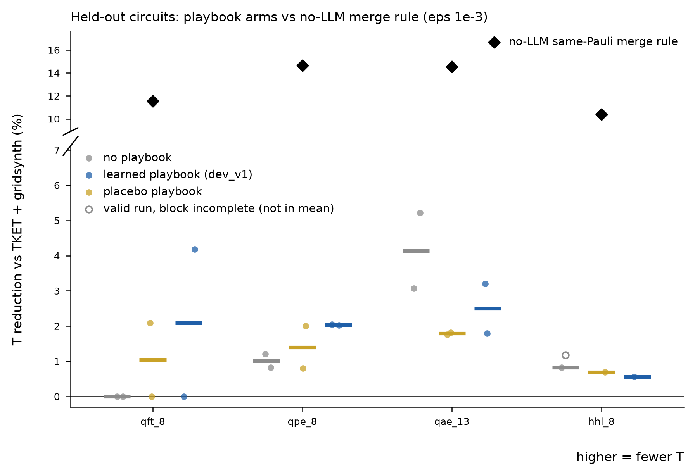

# Playbook ablation v1: does a learned shared playbook help on held-out circuits?

**Verdict: no detectable effect (null result).** On the held-out circuits the frozen learned playbook did not beat either the no-playbook arm or the placebo playbook. Paired over the 7 complete circuit x seed blocks, learned minus none = +0.38 percentage points of T reduction (bootstrap 95 % CI -1.21 to +1.93; sign test 4+ / 2- / 1 tie, p = 0.69); learned minus placebo = +0.66 pp (CI -0.60 to +1.99; 4+ / 3- / 0 tie, p = 1.00). Both intervals contain zero and are wide compared with the effect sizes; seed-to-seed spread within an arm (up to 4.2 pp on qft_8, 2.1 pp on qae_13) is as large as any between-arm difference. The learned playbook held only ONE active rule, so this tests that single rule, not a rich playbook. All three LLM arms stay far below the no-LLM same-Pauli merge rule (10.4-14.7 % vs B0).

## Setup

* Model `claude-sonnet-5` via in-platform host.llm, thinking disabled, max_tokens 2000, batch 5; ledger v1; eps_total = 1e-3; TKET FullPeepholeOptimise inputs (`core.circuit.load_input`, the shared stage-1 input files for the held-out circuits); canonical T (pygridsynth at eps_rz = eps_synth / N_Rz); archive 4, p_best 0.7; windows ranked by T-cost, equal-cost windows ordered by a seed-dependent hash (`WindowLoop(seeded_ties=True)`, new, default off). Seeds set parent selection and the tie order; the LLM's own sampling is not seeded. Script `experiments/window_ablation.py`, report code `experiments/window_ablation_report.py`.
* **Step 1, learning (development circuits only):** fresh playbook `playbooks/dev_v1.json`, fixed order qft_4, qft_5, qft_6, qft_7, qpe_6, qae_11, qae_15, 33 LLM calls each (219 proposer + 12 reflector in total), evidence gate = accepted AND T reduced. Result: 28 rules proposed, **1 active** (R3), 11 candidate, 16 retired; 685,358 tokens. Frozen; SHA-256 `6e6b65fa4e40596ad8dce14ff49e93759126853546c60a159bded02d0b9004f5`. Details, per-circuit table and the top candidate rules: `playbooks/dev_v1.md`.
  * R3 (active): "A 'fix' proposal that removes a single rz without compensating for the Clifford gates around it on the same qubit will fail the operator-norm verifier; track the full Pauli-frame/basis change across the window before deleting or merging any rotation gate." Promoted on 3 improving prompts of 37 shown vs 0 of 53 hidden (z = +1.65, threshold 1.64).
* **Step 2, placebo:** `playbooks/placebo_v1.json`, one hand-written active rule (generic: re-read the reply, follow the output format, be concise), 292 vs 255 characters, same JSON format and rendering path; SHA-256 `27162b1933a1aaad9b7ffb2401a0ca26a41d9fd9ff22da6429e19a84c0bdbffb`. **Deviation:** the brief asked for the same number of active rules AND at least 3; with one learned active rule both cannot hold, and matching the learned arm (1 rule, similar length) was chosen.
* **Step 3, ablation:** qft_8, qpe_8, qae_13, hhl_8 x {none, learned, placebo} x seeds {0, 1}; 20 proposer calls per run, no reflector in any arm (frozen playbooks show ACTIVE rules only, consume no loop RNG and are re-hashed before and after every run). One JSON line per LLM call in `ho_<circuit>_<arm>_s<seed>.jsonl`.
* **Budget cut to 2 seeds (all arms equally).** After step 1 (685 k tokens) one seed of 12 runs cost ~717 k tokens, so seeds {0,1,2} would have totalled ~2.84 M, over the ~2.5 M budget; seed 2 was not run for any arm.
* **Two invalid runs (infrastructure).** The platform's per-frame host.llm token ceiling (2.0 M) was reached during the last two runs: `ho_hhl_8_learned_s1` (10 of 20 calls errored) and `ho_hhl_8_placebo_s1` (20 of 20 errored). Their logs are kept (append-only) and flagged `valid = False`; the whole hhl_8 seed-1 block is excluded from paired statistics and means (the valid `ho_hhl_8_none_s1`, T 35,034 = 1.17 %, is shown as an open marker). So hhl_8 has one seed. Re-running the two runs (new tags, `run_ablation(..., circuits=('hhl_8',), arms=('learned','placebo'), seeds=(1,), tag_suffix='_rerun', rerun_of='token ceiling')`) needs a fresh frame.
* No-LLM control: `experiments/window_pmerge_control.run_one` at 1e-3 once per circuit (`control_pmerge.json`; identical to the stage-1 control).
* Validity: every final circuit (all 24 runs, incl. the invalid ones) passed the check against the ORIGINAL qseed circuit (dense unitary for n = 8; 4 Haar-random states for qae_13, a lower bound, not a certificate); error bound <= 1e-3 everywhere; verifier digest checked at start and end of every run.

## Results (T reduction vs B0 = TKET + gridsynth, %, higher is better)

| circuit | B0 | none (s0, s1) | learned (s0, s1) | placebo (s0, s1) | learned - none (pp) | learned - placebo (pp) | merge rule (no LLM) |
|---|---|---|---|---|---|---|---|
| qft_8 | 2,391 | 0.00, 0.00 (mean 0.00) | 0.00, 4.18 (mean 2.09) | 2.09, 0.00 (mean 1.05) | +2.09 | +1.05 | 11.54 (T 2,115) |
| qpe_8 | 14,761 | 0.83, 1.21 (mean 1.02) | 2.02, 2.05 (mean 2.03) | 2.00, 0.80 (mean 1.40) | +1.02 | +0.63 | 14.66 (T 12,597) |
| qae_13 | 7,821 | 3.07, 5.22 (mean 4.14) | 3.20, 1.79 (mean 2.49) | 1.76, 1.82 (mean 1.79) | -1.65 | +0.70 | 14.55 (T 6,683) |
| hhl_8 | 35,450 | 0.83 (mean 0.83) | 0.56 (mean 0.56) | 0.69 (mean 0.69) | -0.27 | -0.13 | 10.40 (T 31,762) |

| arm (7 paired blocks) | mean reduction % | proposer calls | proposals | accepted | acceptance rate | declined calls | mean calls to best (runs that improved) | tokens |
|---|---|---|---|---|---|---|---|---|
| none | 1.59 | 140 | 48 | 17 | 35% | 92 | 9.0 (5/7) | 402,798 |
| learned | 1.97 | 140 | 45 | 19 | 42% | 98 | 11.7 (6/7) | 411,889 |
| placebo | 1.31 | 140 | 53 | 15 | 28% | 86 | 9.5 (6/7) | 405,905 |

Paired differences over the 7 complete blocks (pp of T reduction; bootstrap 20,000 resamples of blocks; exact two-sided sign test):

| comparison | mean | median | + / - / tie | sign test p | bootstrap 95 % CI |
|---|---|---|---|---|---|
| learned - none | +0.38 | +0.13 | 4 / 2 / 1 | 0.69 | -1.21 to +1.93 |
| learned - placebo | +0.66 | +0.01 | 4 / 3 / 0 | 1.00 | -0.60 to +1.99 |
| placebo - none | -0.28 | -0.14 | 2 / 4 / 1 | 0.69 | -1.55 to +0.86 |

## Reading

1. **No arm is distinguishable from another.** Per circuit the sign of learned - none flips: qft_8 +2.09, qpe_8 +1.02 (both seeds positive), qae_13 -1.65, hhl_8 -0.27 (one seed). qpe_8 is the only circuit where learned beat both other arms on both seeds (2.02 / 2.05 % vs none 0.83 / 1.21 %, placebo 2.01 / 0.80 %) — 2 seeds, not evidence on its own. With 7 pairs, a sign test cannot reach p < 0.05 unless all 7 pairs agree (p = 0.016); the observed split is 4 / 2 / 1.
2. **Placebo does not help either**, and the placebo - none difference has the same magnitude as learned - none, which bounds what prompt context of this size does here.
3. **Matched calls, nearly matched tokens:** 140 proposer calls per arm in the paired blocks; the one-rule playbooks add ~2 % input tokens. The learned arm had a slightly higher acceptance rate (19 / 45 vs 17 / 48 none, 15 / 53 placebo) and declined a few more windows; neither translated into a measurable T difference.
4. **The loop's absolute effect is small and the control dominates it.** Best single LLM run: 5.2 % (qae_13, none, s1). The deterministic same-Pauli merge rule gives 11.5 / 14.7 / 14.6 / 10.4 % in seconds without tokens — the same finding as stage 1, now on 3 arms x 2 seeds.
5. **Why the playbook is near-empty:** the dev runs each accepted one rewrite (qae_15: none), so the evidence gate saw very few improving prompts; 27 of 28 rules never cleared it. The learned rule is generic (track the Pauli frame before deleting a rotation) and largely restates information already in the prompt (the Pauli column and merge rule).

## Caveats

* 2 seeds (budget), hhl_8 1 seed (token ceiling); the LLM's sampling is not seeded, so seeds are not exact replays across arms — first batches see identical prompts in none vs learned only up to the rule text.
* Held-out qft_8 / qpe_8 / qae_13 are larger members of the qft / qpe / qae families used for learning (the brief's design); hhl_8 is a family not seen in development.
* qae_13 is checked with 4 random states (a lower bound on the distance).
* `_view_001_ablation_figure.png` at the repo root is a stray preview image written while checking the figure; not part of the results.

## Files

| file | content |
|---|---|
| `ablation_results.csv` | one row per circuit x arm x seed (24 rows): final T, % vs B0, reduction %, calls to best, proposals, accepted, acceptance rate, tokens, validity flags, final check |
| `paired_stats.json` | paired differences, sign tests, bootstrap CIs |
| `ablation_figure.{png,pdf}` | figure above |
| `FROZEN.sha256` | SHA-256 of `playbooks/dev_v1.json` and `playbooks/placebo_v1.json` |
| `dev_<c>_e3.*` | step-1 learning runs (log, summary, best circuit, playbook snapshot after each circuit) |
| `ho_<c>_<arm>_s<seed>.*` | held-out runs (log, summary, best circuit, frozen playbook copy) |
| `_dev_progress.jsonl`, `_ablation_progress.jsonl` | one line per run |
| `control_pmerge.json` | no-LLM same-Pauli merge control |

Tokens: step 1 685,358; step 3 1,329,504 (incl. 36,421 in the invalid partial run); total 2,014,862.
