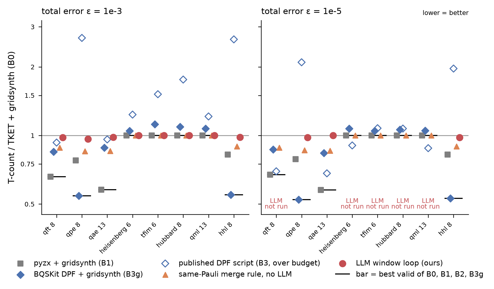

# Stage-1 runs of the window core — PRELIMINARY (2026-10-13)

**Read this first.** These results are preliminary: 8 small circuits (6–13 qubits), one seed, ~40 proposer calls
per run, and the playbook rules were learned on the same circuits they are measured on (no held-out rows). They
are a functional test of the harness against a fixed baseline protocol, not evidence about LLM-assisted
optimization in general.

## Setup

* Protocol: skill `bqskit-ft-reference-baseline`; baselines B0–B3 and B3g from
  `results/bqskit_baselines/stage1/stage1_baselines_v2.csv` (`t_count_canon`, pygridsynth 2.0.0 recount; bqskit-ft
  `algorithmic_error_dpf` @ 2e99ba614d48970b9afefc0b8c32860c3a3dc9f1). Our T uses the same pygridsynth at
  eps_rz = eps_synth / N_Rz, so the numbers are directly comparable.
* **Bar** = best *valid* of B0, B1, B2, B3g per circuit × ε. B3 (published `alg_err_workflow.py`) is reported but
  flagged ⚑: its code-accounted bound is 1.7 ε at 1e-3 and 21.5 ε at 1e-5 (ERROR_ACCOUNTING.md).
* Input: the shared TKET FullPeepholeOptimise files `results/bqskit_baselines/stage1/inputs/<c>_tket.qasm`.
* Error ledger **v1** (`circuitevolve/core/ledger.py`): window pool capped at ε/4, per-rewrite allowance ≤ ε/16,
  unspent budget returns to synthesis; acceptance and reported T at eps_rz = (ε − d_input − ceil_q Σd_w)/N_Rz,
  q = ε·2⁻¹². Bound d_input + Σd_w + N_Rz·eps_rz ≤ ε in operator norm. With no accepted rewrite T equals B0
  exactly (regression test on qft_8 and tfim_6; observed on all 5 runs with no accept).
* Actions: exact rewrite (```window) and **fix-and-refit** (```fix: the LLM names rotations and targets 0 / k·π/4 /
  2πm/2^k, k ≤ 4; BQSKit instantiation re-fits the window's other angles; the frozen verifier checks the result).
  The prompt shows per rotation: angle, nearest π/4 multiple, |Δ|, plain snap distance, T, and its Pauli frame P.
* Backend: in-platform host.llm, reasoning model, thinking disabled, max_tokens 2000; 44 calls per run (batches of
  5; a reflector call every 10 proposer calls, skipped without new verifier evidence, so 40–44 proposer calls).
* One playbook `playbooks/stage1.json` (started empty, evidence = accepted and T reduced) carried across runs in a
  fixed order: all 1e-3 runs in the order qft_8, qpe_8, qae_13, heisenberg_6, tfim_6, hubbard_8, qml_13, hhl_8,
  then the 1e-5 runs; snapshot after each run: `stage1_<c>_e<k>_playbook.{json,md}`.
* **Dropped runs (token budget).** The eight 1e-3 runs used 1.10 M tokens, so only three 1e-5 runs fit near the
  ~1.5 M target. Dropped at 1e-5: heisenberg_6, tfim_6, hubbard_8, qml_13 (no gain at 1e-3) and qft_8 (smallest gain
  at 1e-3, one rotation). Run at 1e-5: qpe_8, qae_13, hhl_8. Total 1,638,040 tokens (1,381,549 in + 243,111 out
  for the 11 runs, plus 13,380 for a 5-call dev run) — **about 9 % over the ~1.5 M target**.
* Every final circuit was checked against the ORIGINAL qseed circuit (dense unitary for n ≤ 10, 4 Haar-random
  states for qae_13 / qml_13 — a lower bound on the distance, not a certificate): all pass.

## Result: LLM loop vs B0–B3

| circuit | ε | B0 | B1 | B2 | B3 (bound/ε) | B3g | bar (arm) | **ours** | ours vs B0 | ours vs bar | rot. before→after | accepted fix / window | LLM calls (prop+refl) | tokens in / out | bound | check vs original |
|---|---|---|---|---|---|---|---|---|---|---|---|---|---|---|---|---|
| qft_8 | 1e-3 | 2391 | 1577 | 2391 | 2226 (1.7x) ⚑ | 2029 | 1577 (B1) | **2341** | -2.1 % | +48.4 % | 48→47 | 1 / 0 | 44 (42+2) | 85,823 / 24,546 | 0.0009998 | unitary 4.3e-15 |
| qft_8 | 1e-5 | 3299 | 2219 | 3299 | 2297 (21.5x) ⚑ | 2866 | 2219 (B1) | not run | | | | | | | | |
| qpe_8 | 1e-3 | 14761 | 11485 | 14761 | 39565 (1.7x) ⚑ | 8020 | 8020 (B3g) | **14225** | -3.6 % | +77.4 % | 257→248 | 6 / 0 | 44 (40+4) | 141,357 / 23,035 | 0.0009998 | unitary 9.0e-14 |
| qpe_8 | 1e-5 | 19853 | 15651 | 19853 | 41604 (21.5x) ⚑ | 10391 | 10391 (B3g) | **19471** | -1.9 % | +87.4 % | 257→252 | 5 / 0 | 44 (41+3) | 163,539 / 21,623 | 9.998e-06 | unitary 9.2e-14 |
| qae_13 | 1e-3 | 7821 | 4527 | 7821 | 7516 (1.7x) ⚑ | 6909 | 4527 (B1) | **7679** | -1.8 % | +69.6 % | 145→143 | 0 / 1 | 44 (40+4) | 134,542 / 22,059 | 0.0009998 | statevector 2.5e-11 |
| qae_13 | 1e-5 | 11017 | 6361 | 11017 | 7515 (21.5x) ⚑ | 9237 | 6361 (B1) | **11017** | +0.0 % | +73.2 % | 145→145 | 0 / 0 | 44 (43+1) | 123,595 / 21,533 | 1e-05 | statevector 2.2e-13 |
| heisenberg_6 | 1e-3 | 8200 | 8200 | 8200 | 10128 (1.7x) ⚑ | 8600 | 8200 (B0=B1=B2) | **8200** | +0.0 % | +0.0 % | 150→150 | 0 / 0 | 44 (43+1) | 125,190 / 15,559 | 0.001 | unitary 2.6e-14 |
| heisenberg_6 | 1e-5 | 11200 | 11200 | 11200 | 10128 (21.5x) ⚑ | 12000 | 11200 (B0=B1=B2) | not run | | | | | | | | |
| tfim_6 | 1e-3 | 8560 | 8560 | 8560 | 12990 (1.7x) ⚑ | 9600 | 8560 (B0=B1=B2) | **8560** | +0.0 % | +0.0 % | 160→160 | 0 / 0 | 44 (43+1) | 110,363 / 33,883 | 0.001 | unitary 3.5e-14 |
| tfim_6 | 1e-5 | 11840 | 11840 | 11840 | 12742 (21.5x) ⚑ | 12400 | 11840 (B0=B1=B2) | not run | | | | | | | | |
| hubbard_8 | 1e-3 | 4312 | 4312 | 4312 | 7588 (1.7x) ⚑ | 4712 | 4312 (B0=B1=B2) | **4312** | +0.0 % | +0.0 % | 84→84 | 0 / 0 | 44 (42+2) | 80,835 / 17,503 | 0.001 | unitary 2.3e-14 |
| hubbard_8 | 1e-5 | 6000 | 6000 | 6000 | 6434 (21.5x) ⚑ | 6368 | 6000 (B0=B1=B2) | not run | | | | | | | | |
| qml_13 | 1e-3 | 6326 | 6326 | 6326 | 7668 (1.7x) ⚑ | 6790 | 6326 (B0=B1=B2) | **6326** | +0.0 % | +0.0 % | 118→118 | 0 / 0 | 44 (44+0) | 93,849 / 18,595 | 0.001 | statevector 9.0e-15 |
| qml_13 | 1e-5 | 8716 | 8716 | 8716 | 7668 (21.5x) ⚑ | 9162 | 8716 (B0=B1=B2) | not run | | | | | | | | |
| hhl_8 | 1e-3 | 35450 | 29205 | 35450 | 93637 (1.7x) ⚑ | 19443 | 19443 (B3g) | **34797** | -1.8 % | +79.0 % | 583→573 | 12 / 0 | 44 (40+4) | 155,283 / 21,010 | 0.0009998 | unitary 3.3e-13 |
| hhl_8 | 1e-5 | 47228 | 38987 | 47228 | 92889 (21.5x) ⚑ | 25043 | 25043 (B3g) | **46280** | -2.0 % | +84.8 % | 583→572 | 12 / 0 | 44 (40+4) | 167,173 / 23,765 | 9.998e-06 | unitary 3.6e-13 |

Totals: 484 LLM calls (458 proposer + 26 reflector), 1,624,660 tokens for the 11 runs. Wall time 82–254 s per run.



## No-LLM control: deterministic same-Pauli merges (`experiments/window_pmerge_control.py`)

The prompt's Pauli column makes one class of rewrite mechanical: two rotations with the same Pauli frame and a
commuting path merge exactly. Applying exactly that rule greedily to every window until nothing changes (no LLM,
same windows, same verifier, same ledger and metric, under 15 s per circuit) gives:

| circuit | ε | no-LLM same-Pauli merges | T | rotations | vs B0 | vs bar | LLM loop T |
|---|---|---|---|---|---|---|---|
| qft_8 | 1e-3 | 5 | 2115 | 43 | -11.5 % | +34.1 % | 2341 |
| qft_8 | 1e-5 | 5 | 2913 | 43 | -11.7 % | +31.3 % |  |
| qpe_8 | 1e-3 | 23 | 12597 | 224 | -14.7 % | +57.1 % | 14225 |
| qpe_8 | 1e-5 | 23 | 17099 | 224 | -13.9 % | +64.6 % | 19471 |
| qae_13 | 1e-3 | 19 | 6683 | 126 | -14.6 % | +47.6 % | 7679 |
| qae_13 | 1e-5 | 19 | 9433 | 126 | -14.4 % | +48.3 % | 11017 |
| heisenberg_6 | 1e-3 | 0 | 8200 | 150 | +0.0 % | +0.0 % | 8200 |
| heisenberg_6 | 1e-5 | 0 | 11200 | 150 | +0.0 % | +0.0 % |  |
| tfim_6 | 1e-3 | 0 | 8560 | 160 | +0.0 % | +0.0 % | 8560 |
| tfim_6 | 1e-5 | 0 | 11840 | 160 | +0.0 % | +0.0 % |  |
| hubbard_8 | 1e-3 | 0 | 4312 | 84 | +0.0 % | +0.0 % | 4312 |
| hubbard_8 | 1e-5 | 0 | 6000 | 84 | +0.0 % | +0.0 % |  |
| qml_13 | 1e-3 | 0 | 6326 | 118 | +0.0 % | +0.0 % | 6326 |
| qml_13 | 1e-5 | 0 | 8716 | 118 | +0.0 % | +0.0 % |  |
| hhl_8 | 1e-3 | 58 | 31762 | 525 | -10.4 % | +63.4 % | 34797 |
| hhl_8 | 1e-5 | 58 | 42286 | 525 | -10.5 % | +68.9 % | 46280 |

## Observations

1. **The ledger fix works as specified.** Five runs with no accepted rewrite reproduce B0's t_count_canon exactly
   (heisenberg_6, tfim_6, hubbard_8, qml_13 at 1e-3; qae_13 at 1e-5). Accepted rewrites spent ≤ 2.5e-11 in total
   (all were exact merges up to floating point), so eps_synth stayed within ε·2⁻¹² of ε.
2. **The LLM loop improves B0 by 1.8–3.6 % on the four circuits with dyadic / structured phases and is 48–87 % above
   the bar everywhere it improves.** qft_8 −2.1 %, qpe_8 −3.6 % / −1.9 %, qae_13 −1.8 % / 0 %, hhl_8 −1.8 % / −2.0 %
   (1e-3 / 1e-5). The bar on these rows is pyzx (B1: qft, qae) or BQSKit's DPF stage + gridsynth (B3g: qpe, hhl).
   On the Trotter circuits (heisenberg, tfim, hubbard, qml) every arm is at B0 except the over-budget B3 and B3g
   (which loses ~5–12 % there); we match B0 = bar.
3. **Fix-and-refit is the productive action.** 36 of 37 accepted rewrites were fixes: 28 deleted one rotation
   (target 0) that the refit absorbed into another, 8 set one or two rotations to π, ±π/2 or 3π/4 (with a refit of
   the rest); one exact window rewrite on qae_13 at 1e-3 removed two rotations. Of the failures, 55 were verifier
   rejections (distance 2.3e-3 to 1.45 against allowances ≤ 6.25e-5 at 1e-3, i.e. changes nothing could absorb) and
   one was a metric rejection (a qft_8 window rewrite with unchanged T and rotation count); none was rejected by
   the ledger.
4. **The no-LLM same-Pauli rule beats the LLM loop on every row where either changes anything**, in seconds and
   with no tokens: e.g. qpe_8 12,597 vs 14,225 T, hhl_8 31,762 vs 34,797 T at 1e-3. Two reasons are visible in
   the logs: (a) coverage — the rule visits every window repeatedly, while the runs proposed on 24 of qpe_8's 30
   window positions and 24–25 of hhl_8's 81; (b) the model declines most windows (25/40 on qpe_8, 18/40 on hhl_8,
   35–44 of 42–44 proposer calls on the Trotter circuits) and, when it proposes, often batches deletions that
   cannot be absorbed. On qpe_8, where coverage was high, (b) is the main cause.
   So in this configuration the LLM adds nothing over a phase-folding-style rule that the prompt itself describes.
   Even the rule stays far above the bar (+31 % to +69 %): B1 and B3g restructure across window boundaries
   (pyzx globally, DPF with re-instantiation at a 0.4 ε HS budget per block), which window-local exact merges cannot.
5. Rotation counts: in hhl_8 twelve fixes were accepted but the best circuit has 10 (1e-3) / 11 (1e-5) fewer
   rotations — some accepts were on other archive members, not on the lineage of the final best.

## Learned playbook (`playbooks/stage1.json`, `playbooks/stage1.md`)

63 rules were proposed by the reflector over 26 reflector calls; 3 are ACTIVE, 8 candidates, 52 retired. The active
rules (promoted during the last 1e-3 run, hhl_8, and the first 1e-5 runs; evidence z = 1.8–2.1 on 8–20 prompts):

* **R36** — before proposing `op N->0`, check that the deletion can actually be absorbed; deleting several unrelated
  non-zero rotations accumulates error.
* **R38** — batching 3+ `op N->0` deletions failed (distance 0.18–0.61); cap a fix at 2 deletions.
* **R41** — 5-index all-zero batches failed (distance 0.1–0.2); prefer single-op fixes.

Quality caveat: the rules are about not over-batching deletions — sensible, but generic. Several candidate and
active rules tell the model to "resimulate" or "matrix-log solve" the target, which it cannot do inside a prompt;
the evidence gate measures correlation with accepted improvements on the same circuits, so these rules have NOT
been shown to transfer. None of them encodes the same-Pauli criterion the control uses.

## Caveats

* Preliminary: small circuits, one seed, ~40 calls per run, playbook learned and measured on the same circuits.
* B3-type numbers (B3, B3g) are stochastic (±15 % between runs, README of the baselines); B0, B1, B2 are deterministic.
* B3g accounts its DPF stage in BQSKit's HS distance (≤ op norm; op norm can be up to √d larger); our bound is in
  operator norm, i.e. at least as strict. B4 (phase kickback, k > 3) is out of scope; nothing here uses ancillas.
* qae_13 and qml_13 (13 qubits) are checked with 4 random states only.
* 1e-5 rows for five circuits were not run (token budget); their "ours" would be B0 if nothing were accepted, but
  that is not a measurement and is left blank.

## Suggested next steps

1. Make the same-Pauli merge (phase folding) a deterministic toolbox pass applied before and after every LLM batch,
   and spend LLM calls only on what it cannot do (cross-window restructuring, approximate DPF-style fixes).
2. Start from the stronger inputs (pyzx B1 output, B3g pre-gridsynth circuit) so the LLM works on the residual.
3. Freeze `playbooks/stage1.json` and evaluate it on held-out circuits before reading anything into the rules.

## Files

| file | content |
|---|---|
| `stage1_results.csv` | one row per circuit × ε: B0–B3, B3g, bar, ours, control, accepts by action, calls, tokens, bound, check |
| `stage1_figure.png` / `.pdf` | T-count / B0 per circuit × ε: B1, B3g, B3 (open, over budget), control, ours, bar |
| `stage1_<c>_e<k>.jsonl` | one line per LLM call (prompt, response, candidates, verifier records, decisions) |
| `stage1_<c>_e<k>_summary.json`, `_best.qasm`, `_playbook.{json,md}` | per-run summary, best circuit, playbook snapshot |
| `_stage1_progress.jsonl` | one line per run as it finished |
| `control_pmerge.json` | the no-LLM control |
| `dev_qpe_8_e3*` | 5-call dev run before the Pauli column was added (nothing accepted; not part of the results) |
